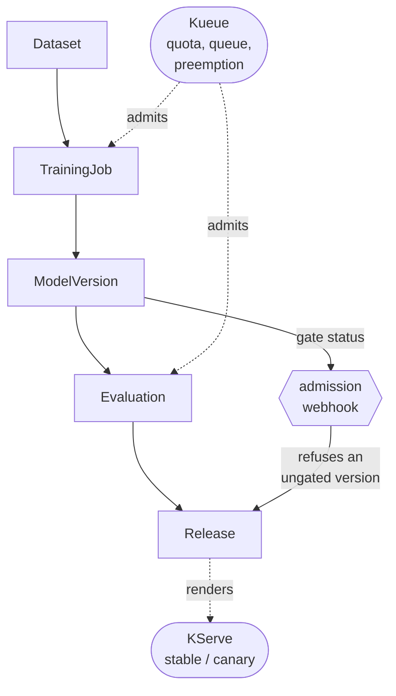

# k8s-ai-platform

An internal AI model operations platform on Kubernetes: register a dataset version, train a model,
evaluate it against a golden set, and only then let it take production traffic.

It is also a training environment. The repository has been reset to a blank-start curriculum: you
will install the tools, run Kubebuilder yourself, generate the CRDs yourself, and write the cluster
setup scripts yourself. Generated artifacts are part of the lesson, not something to hide.

> **Status: blank rebuild.** The previous generated Kubebuilder scaffold was archived in commit
> `131697f` before this reset. Use it as a reference only after attempting the task from the blank
> state.

## Read in this order

| Document                                           | What it is                                                                 |
| -------------------------------------------------- | -------------------------------------------------------------------------- |
| [docs/requirements.md](docs/requirements.md)       | The requirements. User stories and required behaviour. Source of truth.    |
| [docs/architecture.md](docs/architecture.md)       | The design: what is built here, what is adopted, and where the line falls. |
| [docs/training-tasks.md](docs/training-tasks.md)   | The blank-start curriculum.                                                |
| [docs/progress.md](docs/progress.md)               | The maintainer log.                                                        |
| [docs/agent-container.md](docs/agent-container.md) | Optional agent sandbox, available but not automatically enabled.           |

## Target shape



Kueue and KServe are other people's operators, configured well. Everything else in that diagram —
five custom resources, five controllers, one webhook — will be built here as the levels progress.

## Getting started

Start with
[Level 0 in docs/training-tasks.md](docs/training-tasks.md#level-0--bootstrap-from-nothing): install
the CLI tools, then run `kubebuilder init` yourself. The repository intentionally does not currently
contain the operator scaffold: `Makefile`, `PROJECT`, `go.mod`, `api/`, `cmd/`, `config/`,
`internal/`, or generated CRD manifests. It may contain the optional agent sandbox files documented
in [docs/agent-container.md](docs/agent-container.md); those are not part of the operator scaffold.

If you need to compare against the old generated state:

```bash
git show --stat 131697f
git show 131697f:PROJECT
```

Do that after trying the exercise first.
