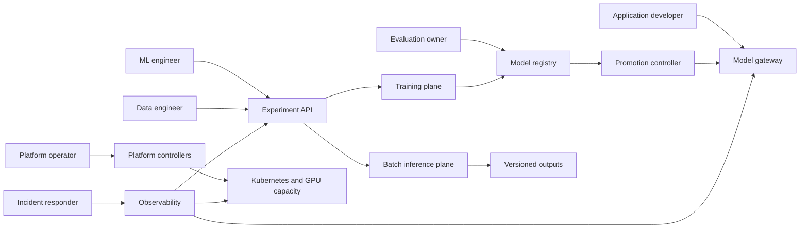
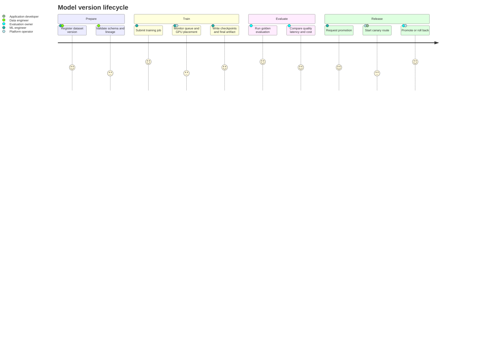
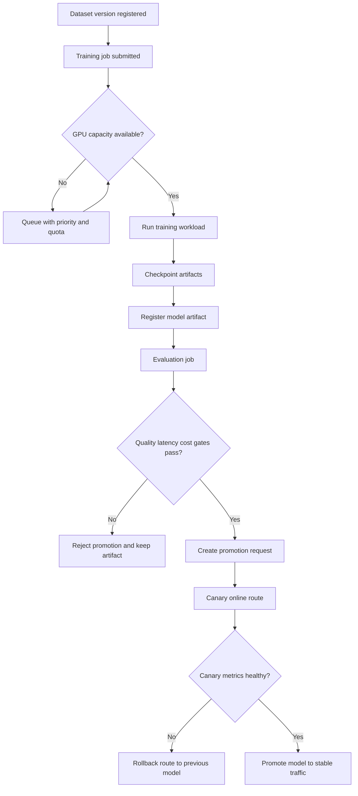
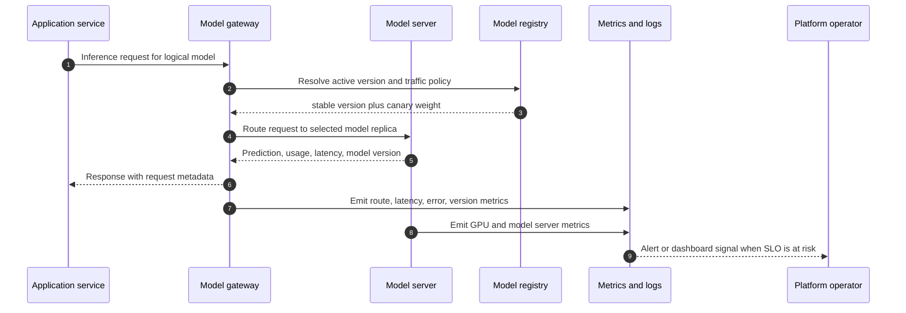
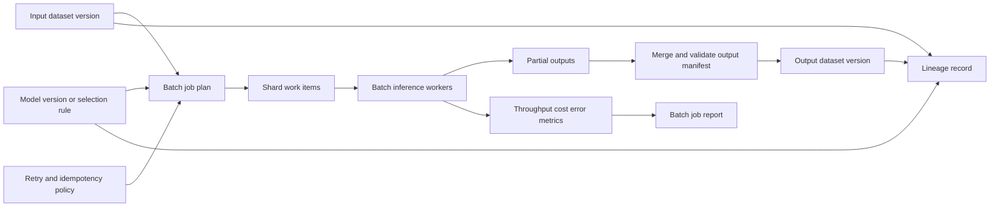
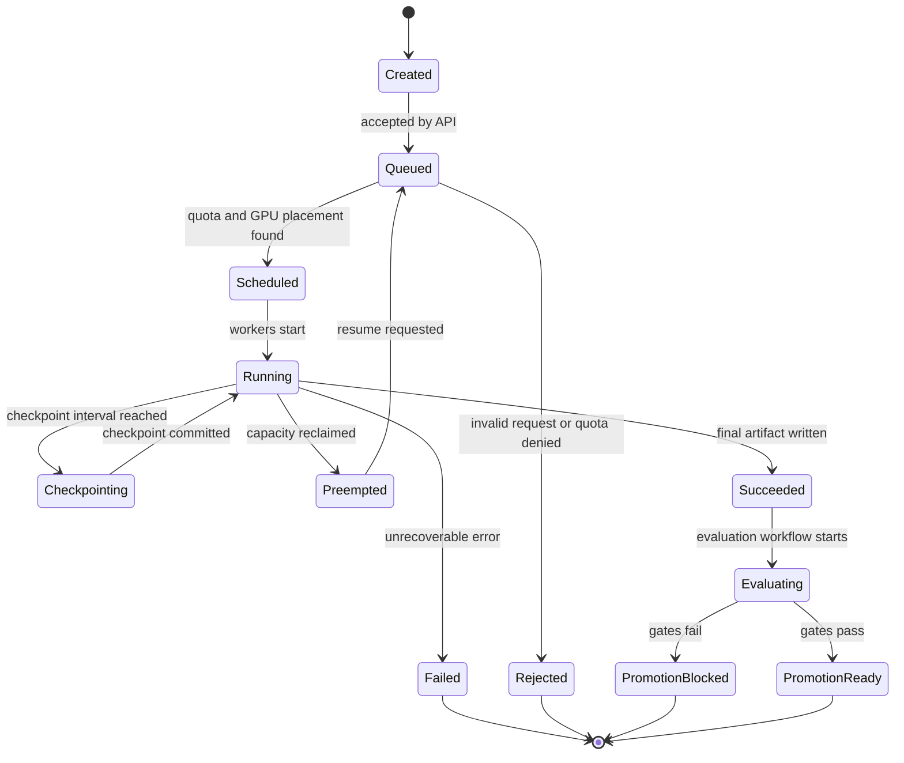
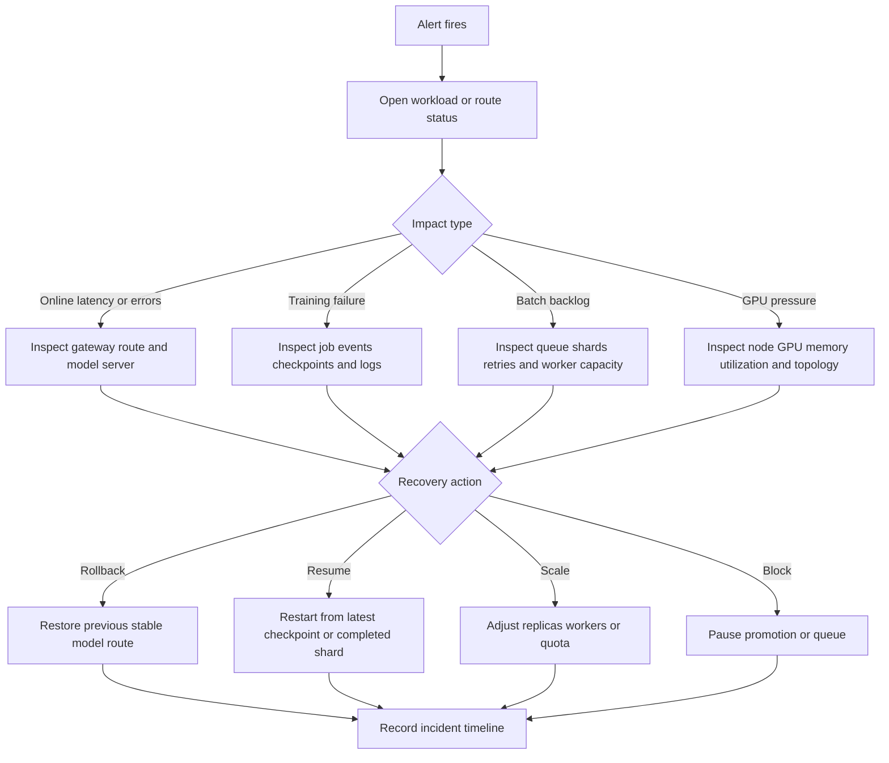

# User Stories

This platform is an internal AI model operations system for running training, evaluation, batch
inference, and online inference on shared Kubernetes infrastructure. The user stories below describe
how different people interact with the system and what each workflow must make visible.

## Users And Responsibilities

| User                        | Goal                                                      | Primary Platform Objects                                             | Success Signal                                                                      |
| --------------------------- | --------------------------------------------------------- | -------------------------------------------------------------------- | ----------------------------------------------------------------------------------- |
| ML engineer                 | Train, evaluate, and promote model versions               | Dataset, training job, checkpoint, model artifact, evaluation        | A model version is reproducible, evaluated, and ready for controlled release        |
| Application developer       | Consume online inference safely                           | Model endpoint, route, traffic policy, API key or service identity   | Requests meet latency and quality expectations without knowing GPU details          |
| Data engineer               | Run batch inference or embedding jobs over versioned data | Dataset, batch job, output dataset, retry policy                     | Large jobs complete idempotently with versioned outputs and cost/throughput reports |
| Platform operator           | Keep shared GPU capacity healthy and fair                 | Queue, quota, cluster, node topology, autoscaling rule, alert        | Inference stays available while training and batch jobs use spare capacity          |
| Product or evaluation owner | Decide whether a model should ship                        | Evaluation report, golden dataset, promotion request, canary metrics | Promotion decisions are based on quality, latency, and cost gates                   |
| Incident responder          | Diagnose and recover failed workloads                     | Logs, metrics, events, checkpoints, rollback action                  | Failures have clear blast radius, owner, reason, and recovery path                  |

## Shared Product Loop

The common path starts with data, produces a model, proves it with evaluation, and releases it
through controlled online inference. Every step must preserve ownership, status, metrics, logs, and
a recovery action.

## Online Inference Stories

### Application Developer

As an application developer, I want to call a stable model endpoint without managing model
placement, GPU memory, or rollout state, so that my service can use AI features with predictable
latency and failure behavior.

Acceptance criteria:

- The endpoint is addressed by logical model name, tenant, and optional version or capability.
- The gateway routes requests according to stable, canary, shadow, or fallback policy.
- Responses expose request ID, model version, latency, token or unit usage, and error class.
- The developer can see whether errors came from client input, gateway policy, model server failure,
  or capacity pressure.
- Rollback does not require application code changes.

### Platform Operator For Online Inference

As a platform operator, I want online inference to have protected capacity and autoscaling rules, so
that user-facing traffic remains available while training and batch workloads compete for GPUs.

Acceptance criteria:

- Each online model defines desired replicas, minimum replicas, maximum replicas, target latency,
  and scaling signal.
- Scaling can use request rate, queue depth, GPU utilization, GPU memory, or custom model metrics.
- Priority and quota prevent low-priority batch jobs from starving online inference.
- Alerts fire for high latency, high error rate, model load failure, GPU memory pressure, and
  exhausted fallback capacity.
- Canary routes can be promoted, paused, or rolled back from a single control action.

## Batch Inference Stories

### Data Engineer

As a data engineer, I want to run batch inference over a versioned input dataset and produce a
versioned output dataset, so that downstream users can reproduce exactly which model and inputs
created each output.

Acceptance criteria:

- A batch job declares input dataset version, model version or model selection rule, output
  location, retry policy, and idempotency key.
- The system records per-shard status, retry count, failure reason, throughput, cost, and output
  checksum or manifest.
- A failed job can resume from completed shards without duplicating outputs.
- The job can run from files, tables, document collections, or queue partitions.
- Outputs are registered as a new dataset version with lineage back to model, prompt/template, input
  data, and job configuration.

### Product Or Evaluation Owner

As a product or evaluation owner, I want to launch controlled offline evaluations using the same
batch infrastructure, so that model quality can be compared before online exposure.

Acceptance criteria:

- Evaluation batch jobs run against golden datasets and record metric definitions.
- Results compare candidate and baseline models.
- Regression thresholds can block promotion automatically.
- Reports include examples of failures, aggregate metrics, latency, and estimated cost.

## Training And Fine-Tuning Stories

### ML Engineer

As an ML engineer, I want to submit training or fine-tuning jobs with dataset, model base, GPU
requirements, and checkpoint policy, so that experiments are reproducible and recoverable.

Acceptance criteria:

- A training job declares owner, base model, dataset version, code/image version, GPU count,
  topology preference, checkpoint frequency, timeout, and priority.
- The system records queue time, assigned node, GPU topology decision, training progress, checkpoint
  paths, logs, metrics, and final artifact path.
- A killed or preempted job can resume from the latest valid checkpoint.
- Failed jobs record a structured reason such as image pull failure, insufficient GPU memory, data
  read error, checkpoint write failure, or user code error.
- Final model artifacts can be registered but cannot be promoted until evaluation gates pass.

### Platform Operator For Training

As a platform operator, I want training jobs to respect quota, priority, gang scheduling, and
topology preferences, so that expensive workloads do not waste GPU capacity or harm serving
reliability.

Acceptance criteria:

- Jobs can wait until all required GPUs are available.
- Multi-GPU jobs can prefer NVLink-local placement when topology metadata is available.
- The scheduler explains placement decisions and failed scheduling attempts.
- Quota and priority rules are visible before and after submission.
- Operators can pause queues, drain workloads, or lower priority without editing user job code.

## Observability And Incident Stories

### Incident Responder

As an incident responder, I want every workload and route to have correlated logs, metrics, events,
and ownership, so that I can identify the failing component and choose a recovery action quickly.

Acceptance criteria:

- Every dataset, job, model, route, and deployment has an owner, status, last transition time, and
  failure reason.
- Dashboards connect API requests, model latency, queue depth, GPU metrics, checkpoint age, and
  error rates.
- Alerts include the affected model, tenant, job, namespace, node, and runbook link.
- Recovery actions include retry, resume from checkpoint, pause queue, scale online replicas, fail
  over route, roll back canary, and reject promotion.
- Post-incident review can reconstruct the timeline from stored platform events.

## End-To-End Role Examples

### Example 1: ML Engineer Ships A Fine-Tuned Support Model

1. Registers dataset version `docs-v12` with schema, owner, and object storage path.
2. Submits training job `ft-support-v7` with base model, GPU count, topology preference, and
   checkpoint frequency.
3. Watches queue time, assigned node, GPU placement explanation, loss, throughput, and checkpoint
   age.
4. Registers the final artifact as model version `support-assistant:v7`.
5. Runs evaluation against the golden support dataset.
6. Requests promotion after gates pass.
7. Observes canary metrics and either promotes to stable or rolls back.

### Example 2: Data Engineer Rebuilds Embeddings

1. Selects input dataset version `docs-v12` and embedding model version `embedder:v3`.
2. Creates batch inference job with shard size, retry policy, output path, and idempotency key.
3. Monitors completed shards, failed shards, retries, throughput, and estimated cost.
4. Resumes failed shards without rewriting successful outputs.
5. Registers output dataset version `docs-v12-embeddings-v3`.
6. Triggers retrieval index rebuild using the registered output dataset.

### Example 3: Application Developer Uses A Stable Endpoint

1. Calls the gateway using logical model name `support-assistant`.
2. Receives responses with request ID, model version, latency, and usage metadata.
3. Sees no application change when the platform canaries `support-assistant:v8`.
4. Can filter application logs by model version if the canary causes regressions.
5. Continues using the same endpoint after promotion or rollback.

### Example 4: Operator Protects Online Inference During GPU Saturation

1. Notices queue depth growing after several training and batch jobs are submitted.
2. Checks that online inference has reserved priority and minimum replica capacity.
3. Confirms batch jobs are waiting instead of preempting online model servers.
4. Adjusts queue priority or pauses low-priority workloads when latency approaches the alert
   threshold.
5. Uses dashboards to confirm latency, GPU memory, and error rate return to normal.

## Required Platform Behavior

The stories imply these product requirements:

- Users interact with logical platform objects, not raw Kubernetes Pods first.
- Every object has owner, status, timestamps, metrics, logs, and failure reason.
- Workloads declare desired behavior: model, dataset, QPS or throughput target, GPU need, routing
  rule, checkpoint policy, retry policy, and autoscaling policy.
- The platform turns desired behavior into Kubernetes jobs, deployments, services, routes, queues,
  and storage records.
- Promotion is gated by evaluation, canary metrics, latency, and cost.
- Online inference has higher availability priority than experimental training and batch work.
- Batch and training jobs are resumable, idempotent, and lineage-tracked.
- Observability is part of the user experience, not a separate afterthought.
