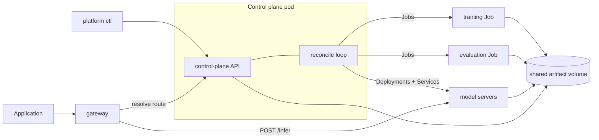

# MVP Design

This document describes what the repository actually implements against the requirements in
[draft.md](draft.md), and — just as important — what it leaves out on purpose so that there is
something left to build.

## Scope

The MVP implements the shared product loop end to end:

| Requirement in draft.md                 | MVP status                                                      |
| --------------------------------------- | --------------------------------------------------------------- |
| Dataset registration and versioning     | Done: immutable `name:version`, owner, row count, golden flag   |
| Training and fine-tuning jobs           | Done: queue, run, checkpoint, resume, structured failure reason |
| Checkpoints and model artifacts         | Done: checkpoints per N steps, model card written on success    |
| Evaluation against golden datasets      | Done: deterministic scoring, report with failures and cost      |
| Promotion gated on quality/latency/cost | Done: gates block promotion, nothing else can                   |
| Online inference with canary rollout    | Done: logical route, weighted split, promote, rollback          |
| Observability                           | Partial: events, status page, Prometheus metrics endpoints      |
| Batch inference                         | Not built — it is exercise 4                                    |
| Quota, priority, gang scheduling        | Not built — it is exercise 5                                    |
| GPU topology awareness                  | Not built — simulated GPUs only                                 |

## Architecture



One binary runs every role, selected by the first argument. The image is `FROM scratch` over a
statically linked binary, so there is nothing to pull and nothing to patch.

### Why Gin only on the control plane

The control-plane API uses Gin; everything else — the Kubernetes client, the gateway, the workers,
the metrics endpoints — is standard library. The split is deliberate:

- The **control plane** is the surface people drive by hand. Route groups, request binding, and a
  browsable OpenAPI page are worth a dependency there.
- The **gateway** is the data path. Every request an application makes passes through it, so it
  stays dependency-free and small. Moving it to Gin would buy ergonomics on a surface with three
  routes and cost a dependency on the hot path.

`internal/api/openapi.yaml` is hand written rather than generated from annotations, and served from
the binary at `/openapi.yaml` with a vendored Swagger UI at `/docs`. Hand writing it keeps the
document reviewable in a pull request; `TestEveryRouteIsDocumented` fails the build if a route is
added without documenting it. Vendoring the UI keeps the page working on a disconnected machine.

### Control plane

`internal/api` is the REST surface, `internal/store` is the metadata database, and
`internal/controller` is the reconcile loop. They run in one pod because the data flow is easier to
follow that way; splitting them is a deliberate exercise.

The loop is the standard controller shape, once every two seconds:

1. **Training.** `Pending` jobs get a Kubernetes Job and a freshly allocated model version. Running
   jobs are polled; success registers the artifact as a model version in `Registered` status,
   failure records a reason read from the pod's container status.
2. **Evaluation.** `Pending` evaluations get a Job. On success the controller reads the report the
   worker wrote to the shared volume, applies the gates, and moves the model version to
   `PromotionReady` or `PromotionBlocked`.
3. **Serving.** Every version referenced by a route gets a Deployment and a Service; every model
   server no route references is deleted. This is what makes rollback instant: routes change,
   workloads follow.

All writes to Kubernetes are server-side applies, so reconciling twice is the same as reconciling
once.

### Release path

A model version can only reach traffic through this sequence, and the API enforces it:

```text
Registered -> Evaluating -> PromotionReady -> Canary -> Stable
                         -> PromotionBlocked (gates failed, or rolled back)
```

`POST /v1/routes/{model}/canary` refuses any version that is not `PromotionReady`. That single check
is the difference between a platform and a deployment script.

### Gateway

The gateway keeps a route table refreshed from the control plane every two seconds and serves from
the last good copy if a refresh fails. Each request picks stable or canary by weight, forwards to
the per-version Service, and returns the request ID, the version that answered, and the lane. Every
error names the layer that produced it (`client`, `gateway`, or `model-server`) so a caller can
triage without platform logs.

The route table carries per-lane readiness, not just weights. A canary has a Service before it has
endpoints, so for a few seconds after the route changes the new version cannot answer anything; the
gateway holds that traffic on stable until the canary reports a ready replica. Without this,
starting a canary fails a burst of requests that no caller could have avoided.

### Simulation boundary

The GPU work is simulated; everything around it is real.

- Training sleeps per step, writes real checkpoint files, and derives a deterministic quality score
  from the model version, so a version always evaluates the same way.
- Evaluation reads the golden dataset from disk and scores against the model card.
- The model server sleeps proportionally to the model's quality, so a worse model really is slower.
- GPUs are requested as CPU and memory, with the same spec shape a real GPU request would take.

Failure injection is built in: `FAIL_AT_STEP` makes a training attempt fail at a chosen step, which
is how the resume path gets exercised.

## Deliberate limits

These are not oversights. Each one is an exercise in [training-tasks.md](training-tasks.md).

- **State is a JSON file** on a host volume, guarded by a mutex and written atomically. One control
  plane replica only; the Deployment uses the `Recreate` strategy to enforce that.
- **No authentication.** Anyone who can reach the API can promote a model.
- **No queue, quota, or priority.** Every job is created as soon as it is seen.
- **No autoscaling.** Replica counts are set by hand through the route.
- **No batch inference plane**, no lineage records for derived datasets.
- **Polling, not watches.** The controller polls the API server instead of using informers.
- **Metrics are exposed but not collected.** There is no Prometheus and no dashboard.
- **The API is unauthenticated and the docs page can drive all of it.** Anyone who can reach `/docs`
  can promote a model; adding auth middleware is exercise 1.3.
- **Artifacts belong to root.** Containers write the shared volume as root, so the host user cannot
  delete them directly; `make reset` cleans them from inside the node.
