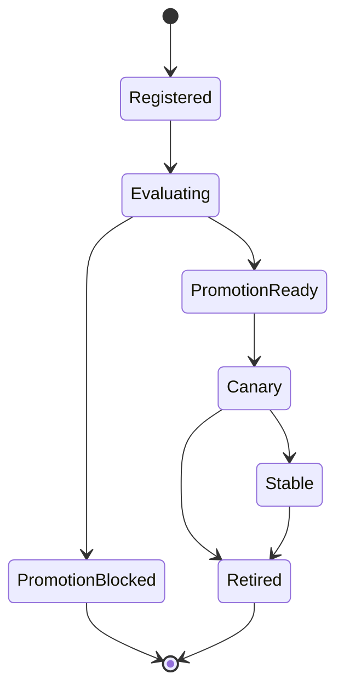

# Architecture

What this platform builds, and — more importantly — what it refuses to build.

The requirements are in [requirements.md](requirements.md). This document is how they are met. The
exercises that get you there are in [training-tasks.md](../curriculum/training-tasks.md).

---

## The one idea

An AI platform on Kubernetes is mostly **other people's controllers**. Queueing, quota, gang
scheduling, autoscaling, traffic splitting, GPU discovery — all of it exists, is CNCF-governed, and
is better than what you would write.

What does not exist, and what turns a collection of operators into a platform, is **policy**:

> A model version that has not passed its evaluation gates cannot receive production traffic.

Nobody ships that for you, because it encodes your organisation's judgement. That rule, the lineage
that makes it auditable, and the API your users actually touch — that is the code in this
repository. Most of the rest is configuration.

This is the same line you draw in a Spring service. You do not reimplement the IoC container; you
learn its annotations and spend your effort on the domain. Here `controller-runtime` is the
container, `kubebuilder` markers are the annotations, and the domain is model release.

---

## Build / adopt

| Concern                                      | Owner                                | What you learn by adopting it                                                             |
| -------------------------------------------- | ------------------------------------ | ----------------------------------------------------------------------------------------- |
| Queue, quota, preemption, borrowing          | **Kueue**                            | `ResourceFlavor` / `ClusterQueue` / `LocalQueue` topology, cohorts, `Workload` conditions |
| Serving, scaling, traffic split              | **KServe**                           | `InferenceService`, `ServingRuntime`, rollout mechanics                                   |
| Distributed training runtime                 | deferred (JobSet / Kubeflow Trainer) | why the user-facing CRD must not name the runtime                                         |
| GPU discovery and health                     | deferred (GPU Operator, DRA, DCGM)   | device advertisement, extended resources                                                  |
| **The vocabulary users request hardware in** | **this repo**                        | why a vendor resource name must not reach a user-facing API                               |
| **Domain objects and their lifecycle**       | **this repo**                        | CRD design, reconcile contracts, conditions                                               |
| **The promotion gate**                       | **this repo**                        | admission control                                                                         |
| **Lineage and ownership**                    | **this repo**                        | what makes an artifact auditable                                                          |

The failure mode of adopting a lot is writing a **YAML translator**: a controller whose entire job
is copying fields from your CRD into somebody else's CRD. If that is all a reconciler does, delete
the CRD and let users write the other one directly. A platform object earns its existence by
carrying policy, lineage, or a stable interface across a runtime swap — ideally all three.

---

## Custom resources

Five user-facing objects, all namespaced. The namespace is the team boundary, which is also Kueue's
`LocalQueue` boundary and the RBAC boundary. That alignment is deliberate and worth not breaking.

A sixth, `AcceleratorClass`, is cluster-scoped and is not a user-facing object at all: it is the
hardware registry an infrastructure engineer writes and a `TrainingJob` only references. It has its
own section, [below](#accelerators-are-a-registry-not-a-vocabulary).

This section decides which objects exist and how they relate. What each field _means_, and which
platform decision would be impossible without it, is in [domain.md](domain.md) — including the
vocabulary the rest of these documents use without stopping to explain: artifact, lineage, base
model, golden dataset, gate, canary.

### `Dataset`

A versioned, immutable input. No Kubernetes analogue; a pure platform object.

```yaml
spec: { uri, owner, rows, checksum, golden }
status:
  { conditions, phase, observedRows, observedChecksum, lastResolvedTime }
```

`rows` and `checksum` appear on both sides on purpose. In `spec` they are the user's claim about
what they registered; in `status` they are what the controller actually found at the URI. A silently
rewritten artifact is only detectable because the two can disagree — which is the reason this is an
object at all rather than a URI string on a training job.

`status.phase` is only a short `kubectl get` summary; conditions remain the source of truth. The
initial API should allow these phases:

- `Pending` — accepted by the API server, but not resolved by the controller yet.
- `Ready` — the URI was resolved and the observed metadata matches any user-provided claims.
- `Failed` — resolution or validation failed; the condition reason names the failing layer.

Immutability is enforced in a webhook, not by convention. A golden dataset is the only kind an
`Evaluation` will score against — score a model on the data it trained on and every gate passes and
none of them mean anything.

### `TrainingJob`

A user's training request. The controller renders it into a `batch/v1` Job carrying
`kueue.x-k8s.io/queue-name`, creates it **suspended**, and lets Kueue admit it.

You do not implement queueing. You label into it, then read Kueue's `Workload` conditions
(`QuotaReserved`, `Admitted`, `Preempted`) back into your own status, so a user learns _why_ their
job is waiting without having to learn what Kueue is.

The spec must not name the runtime. Today the child is a Job; later it is a `JobSet` or a Kubeflow
`TrainJob`. If `TrainingJob.spec` survives that swap untouched, the abstraction was real.

### `ModelVersion`

A registered artifact and its position in the release funnel. The heart of the platform.



That graph is the set of legal transitions, not a `phase` field. The position is carried in
conditions, so that "evaluated but blocked" and "promotable but not yet canaried" are both
expressible; a single string would have to pick one. What the diagram defines is which moves the
controller refuses.

Status carries the metrics, the gate results, the source `TrainingJob`, and the `Dataset` that
produced it. That chain is the lineage: from serving traffic back to the rows that made the weights.

### `Evaluation`

Scores a `ModelVersion` against a golden `Dataset`. Also Kueue-admitted — evaluation competes for
the same GPUs as training, so it belongs in the same queue.

On completion it writes metrics into the `ModelVersion` status and moves it to `PromotionReady` or
`PromotionBlocked`, with a reason either way.

### `Release`

The serving intent for a logical model: which version is stable, which is canary, at what split. The
controller renders it into a KServe `InferenceService`.

Application code addresses the `Release`, never a version. A rollback changes this object and
nothing else — no application deploy, no image rebuild.

---

## The gate is an admission webhook

In the previous version of this repository the gate was an `if` statement in an HTTP handler. It
worked, and it protected exactly one path: callers who went through that API.

Here it is a `ValidatingAdmissionWebhook` on `Release`. A `Release` whose `canaryVersion` names a
`ModelVersion` that is not `PromotionReady` is **rejected by the API server**. That holds against
`kubectl apply`, against an Argo CD sync, against a Helm upgrade, against a well-meaning engineer at
2am, and against you.

That is the difference between a platform and a deployment script, expressed in the one place where
it cannot be routed around.

> **Why not `ValidatingAdmissionPolicy`?** CEL policies are the right tool when the rule concerns
> the incoming object, and they need no webhook server to run. They cannot reach into a _different_
> object's status, which is exactly what this rule does. Knowing where CEL stops is the lesson: use
> a policy for the rules that fit it, and a webhook for this one.

---

## From kind to a cloud cluster

The seam is **`ResourceFlavor`** — Kueue's model of "a kind of node", expressed as node labels plus
tolerations. Quota is denominated in flavors.

- **kind, no GPU:** a `cpu-sim` flavor over the kind nodes. Jobs request CPU and memory, and the
  quota arithmetic — borrowing, preemption, queue depth, preemption ordering — is entirely real.
  Only the hardware is not.
- **cloud, GPU:** a `gpu-a100` flavor selecting real nodes, quota denominated in `nvidia.com/gpu`.

A flavor says _which nodes_ and a `ClusterQueue` says _how much_. Neither says what a user is
allowed to ask for, which is the next section's subject.

The `ClusterQueue` shape, the controllers, and the CRDs do not change. Nothing in the repository may
hardcode a node label, a storage class, or a resource name; those live in kustomize overlays under
`config/overlays/{kind,cloud}`. Artifact storage sits behind an interface with a PVC implementation
now and an object-store implementation later.

**If a task cannot be done without an `if kind` branch in Go code, the design is wrong.**

---

## Accelerators are a registry, not a vocabulary

A training request has to say how much hardware it wants. The obvious way is to let the user write
Kubernetes' own words:

```yaml
resources:
  limits:
    nvidia.com/gpu: 2
```

That is rejected here, and the reason is the same one that keeps the runtime out of
`TrainingJob.spec`. `nvidia.com/gpu` is a vendor's extended-resource name. Putting it in the
user-facing API means every manifest, every stored object and every audit record in the fleet names
a vendor, so the day a cluster gains AMD or Gaudi nodes — or the day one team's quota is denominated
in MIG slices rather than whole cards — the platform has no move that does not involve editing other
people's YAML. A resource name is also only one of the four things a piece of hardware needs: the
counter the kubelet advertises, the nodes it lives on, the tolerations that reach them, and the
per-device memory that decides whether a given base model can fit at all.

So users name an **accelerator class** — a platform word, like `a100-80g` or `mi300x` — and the
class is an object an infrastructure engineer registers.

### The decision: data, not a Go interface

The extension point for "our platform now supports a new kind of accelerator" is a **cluster-scoped
`AcceleratorClass` custom resource**, applied by the infrastructure team. It is not a Go interface,
a plugin, or a registry built from `init()` functions in this repository.

This is worth stating as a decision because the instinct runs the other way: a new hardware vendor
feels like a new implementation of an interface. It is not. Compare what each choice costs when a
cluster gets its first AMD nodes:

| Question                                   | `AcceleratorClass` object                     | Go interface in this repo                     |
| ------------------------------------------ | --------------------------------------------- | --------------------------------------------- |
| What does infra do?                        | `kubectl apply` one manifest                  | open a PR against the controller              |
| When does it take effect?                  | next reconcile                                | after a build, an image push and a rollout    |
| Who may do it?                             | RBAC on one resource                          | anyone with merge rights on the whole manager |
| Can two clusters differ?                   | yes, they hold different objects              | no, both run the same binary                  |
| Is the change auditable?                   | yes, it is an API object with a history       | only in git, and only if you know to look     |
| Can a user see what the platform supports? | `kubectl get acceleratorclasses`              | read the source                               |
| What happens if the definition is wrong?   | one object is `Degraded`; others keep working | the manager fails to start                    |

The Go-interface version also has to answer a question it cannot: hardware support is not behavior.
Registering a class contributes _facts_ — a resource name, a device memory size, a flavor name — and
facts belong in `etcd`, where everything else about this platform's state already lives. Compiling
facts into a binary is how you end up rebuilding the control plane to change a number.

Code enters only where there is real behavior to vary, and today there is none: rendering a pod
template from a class is one function with no vendor-specific branches. If a class ever needs
behavior — topology-aware placement across NVLink islands, say — that arrives as a named strategy
field whose legal values are a closed enum in this binary, so the data still selects the behavior
and the behavior is still reviewed, tested and shipped like code.

### What a class carries

```yaml
apiVersion: ml.aiplatform.io/v1alpha1
kind: AcceleratorClass # cluster-scoped
metadata:
  name: a100-80g
spec:
  resourceName: nvidia.com/gpu # the counter the kubelet advertises
  deviceMemory: 80Gi # one device's memory
  flavor: gpu-a100 # the Kueue ResourceFlavor this quota is denominated in
  maxPerJob: 8 # policy: no single run takes the whole fleet
  vendor: nvidia # label only, for metrics and dashboards
status:
  # Available is False when no node advertises resourceName
  conditions: []
  allocatable: 16 # observed, summed over nodes carrying the flavor's labels
```

Each field is there because some platform decision is impossible without it:

| Field          | The decision it enables                                                                                                                                                                                     |
| -------------- | ----------------------------------------------------------------------------------------------------------------------------------------------------------------------------------------------------------- |
| `resourceName` | what the `TrainingJob` controller writes into the pod template's limits, and the resource a `ClusterQueue` must cover for the job to ever be admitted                                                       |
| `deviceMemory` | the admission check "this base model cannot fit in `count` × `deviceMemory`", which is the difference between a refusal at submission and an OOM discovered an hour into a queued GPU allocation            |
| `flavor`       | the link to Kueue's accounting. It is a cross-check, not a copy: the controller refuses a class whose `resourceName` the named flavor's `ClusterQueue` does not cover, because that job would queue forever |
| `maxPerJob`    | a guardrail expressible at admission rather than discovered when one run starves a team                                                                                                                     |
| `allocatable`  | the honest answer to "why is nothing running?" when a class names hardware that no node in this cluster advertises — a class with no capacity is `Available: False`, not silently unschedulable             |

**Node labels and tolerations are deliberately absent.** Kueue's `ResourceFlavor` already carries
`nodeLabels` and `tolerations`, and injects them into the pod on admission. Duplicating them here
would create two sources of truth that drift, and would make this repository a YAML translator for
fields Kueue already owns. `AcceleratorClass` names the flavor and checks the two agree; it does not
restate it. The division is: **Kueue owns where a workload runs and whether it may; this repository
owns what a user is allowed to ask for and whether the ask makes sense.**

### Adding a new kind of accelerator

The test of this design is that the list below contains no Go.

1. The vendor's device plugin or operator runs on the nodes, so the kubelet advertises the extended
   resource. (Adopted, not built — see the build/adopt table.)
2. The nodes carry a label identifying them, and a `ResourceFlavor` selects on it.
3. A `ClusterQueue` covers the new `resourceName` with a `nominalQuota` over that flavor.
4. An `AcceleratorClass` names the resource, the flavor and the device memory.

Steps 1–3 are Kueue's and the vendor's. Step 4 is the only object this repository defines, and users
reach all of it by writing one word in a spec.

---

## Layout

The repository is intentionally blank at the start of the curriculum. The previous generated
Kubebuilder scaffold was archived in commit `131697f`; the training path recreates it instead of
starting with it checked in.

Current files are documentation and project policy only:

```text
README.md
AGENTS.md
docs/
.markdownlint.json
.prettierrc
.prettierignore
.gitignore
```

As the levels progress, the repository should grow into standard Kubebuilder layout. Deviating from
that layout costs you every tool that assumes it.

```text
api/v1alpha1/          CRD types and kubebuilder markers
internal/controller/   one reconciler per kind, plus the envtest suite
internal/webhook/      promotion gate and immutability checks
internal/artifact/     artifact store interface: PVC now, object store later
cmd/main.go            the manager entrypoint
config/                kustomize — crd, rbac, manager, samples, prometheus
config/overlays/       kind and cloud differences
hack/                  scripts you wrote after running the commands manually
deps/                  gitignored pinned upstream checkouts, read as reference
test/e2e/              the loop against a live cluster
docs/
```

### Expected generator deviation

When you recreate the Makefile, keep Kubebuilder's generated targets first. If `deps/` later lives
under the repository root, adjust `make manifests` and `make generate` to name your own package
trees instead of a broad `./...`. `controller-gen` expands `...` by walking the filesystem rather
than by asking the Go tool, so it does **not** skip a nested module the way `go list ./...` does.
That difference is why the archived scaffold eventually used explicit paths.

---

## Conventions

- **Level-triggered, not edge-triggered.** A reconciler reads the world and makes it match the spec.
  It never assumes it saw the previous event. Reconciling twice equals reconciling once.
- **Status is conditions.** `type`, `status`, `reason`, `message`, `observedGeneration`,
  `lastTransitionTime`. A user diagnoses from `kubectl describe` without reading controller logs.
- **Every child object carries an `ownerReference`.** Garbage collection is Kubernetes' job. A
  finalizer exists only for cleanup Kubernetes cannot do, and every finalizer needs a documented
  removal path for when its controller is down.
- **Every state transition emits an Event.** The event log is the incident timeline.
- **Never mutate another operator's CRs beyond the fields you own.** Set what is yours, read their
  conditions, do not fight their controller.
- **Errors name the layer at fault.** A user must be able to tell "your quota is exhausted" from
  "KServe could not pull the image" from "your model failed its gates".
