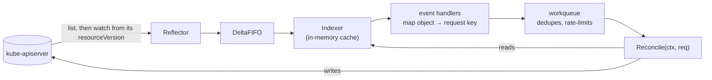

# The API: resources, Get, List, Watch

Every component in [cluster-components.md](cluster-components.md) speaks one protocol. Learn it once
and custom resources come for free: a CRD is not a second mechanism, it is a new path on the same
server, with the same verbs, the same pagination, and the same watch semantics as Pods.

## The address of a thing

Four words that are easy to blur together:

- **Group** — a namespace for kinds: `apps`, `batch`, `kueue.x-k8s.io`, `aiplatform.io`. The core
  group is the empty string, which is why Pods live at `/api/v1` and Deployments at `/apis/apps/v1`.
- **Version** — `v1alpha1`, `v1beta1`, `v1`. Storage is one version; the API server converts.
- **Kind** — the Go-ish type name in the object: `Dataset`, `Deployment`.
- **Resource** — the lowercase plural in the URL: `datasets`, `deployments`. RBAC rules and
  Kubebuilder's `+kubebuilder:rbac` markers name _resources_, not kinds.

So an object's address is `/apis/<group>/<version>/namespaces/<ns>/<resource>/<name>`, or without
the `namespaces/<ns>` segment when the resource is cluster-scoped.

```bash
kubectl api-resources                      # every resource, its group, and whether it is namespaced
                                           # k9s: ctrl-a shows the same list as a pane
kubectl api-versions                       # every group/version served
kubectl explain dataset.spec --recursive   # the schema, served from the CRD itself
kubectl get deployments -v=8 2>&1 | grep GET   # the URL kubectl actually asked for
```

## The verbs

The same eight names appear in the HTTP API, in RBAC rules, and in Kubebuilder markers:

| Verb               | HTTP                         | Returns                               |
| ------------------ | ---------------------------- | ------------------------------------- |
| `get`              | `GET …/<resource>/<name>`    | one object                            |
| `list`             | `GET …/<resource>`           | a `List` object with `items`          |
| `watch`            | `GET …/<resource>?watch=1`   | an open stream of change events       |
| `create`           | `POST …/<resource>`          | the created object                    |
| `update`           | `PUT …/<resource>/<name>`    | the whole object, replaced            |
| `patch`            | `PATCH …/<resource>/<name>`  | the object, partially modified        |
| `delete`           | `DELETE …/<resource>/<name>` | the object, or its deletion timestamp |
| `deletecollection` | `DELETE …/<resource>`        | nothing useful                        |

`list` and `watch` are separate permissions, and a controller needs both. Grant only `get` and
`list` to a controller and its cache will never start.

### Get

One object by name, or a 404. `kubectl get dataset foo` is one GET. Nothing is cached server-side
and nothing is filtered — use it when you know the name.

### List

A collection, plus the metadata that makes watching possible:

```bash
kubectl get pods -A -o json | jq '.metadata.resourceVersion, (.items | length)'
```

Three things to know about `list`:

- **Selectors.** `--selector/-l` filters on labels, which are indexed; `--field-selector` filters on
  a small set of indexed fields such as `metadata.name` or `spec.nodeName`. Anything else is
  filtered client-side after the full list crosses the wire.
- **Pagination.** `?limit=500` returns a `metadata.continue` token for the next page. Listing a
  large resource without a limit is the classic way to wedge an API server's memory.
- **`resourceVersion`.** The list carries the exact point in the stream it represents. This is the
  hinge between `list` and `watch`.

### Watch

A long-lived `GET` with `?watch=1&resourceVersion=N`. The server streams one JSON event per change:

```bash
# Raw, with no kubectl prettifying in the way. Ctrl-C to stop.
RV=$(kubectl get configmaps -n default -o jsonpath='{.metadata.resourceVersion}')
kubectl get --raw "/api/v1/namespaces/default/configmaps?watch=1&resourceVersion=$RV" &
kubectl create configmap demo --from-literal=a=1
kubectl delete configmap demo
kill %1
```

Event types are `ADDED`, `MODIFIED`, `DELETED`, `BOOKMARK`, and `ERROR`. Four properties matter:

- A watch delivers **objects, not diffs**. `MODIFIED` carries the whole new object; you are never
  handed a patch to apply yourself.
- Events are **per object and ordered within one object**, with no ordering guarantee across
  different objects.
- `BOOKMARK` carries only a newer `resourceVersion`, no object. It lets a client resume after a
  disconnect without replaying everything it has already seen.
- Watches **expire**. The server drops them, the connection breaks, or the requested
  `resourceVersion` ages out of etcd's window and you get `410 Gone`. A correct client relists and
  starts over. This is why reconcilers in this repository are level-triggered: _never assume you saw
  the previous event_, because sometimes you did not.

## List-watch, informers, and the cache

No real controller calls `watch` directly. The pattern underneath `controller-runtime` is:



Consequences you will trip over in task 1.1:

- `mgr.GetClient().Get(...)` reads the **cache**, not the API server. It is nearly free, and it can
  be stale by milliseconds. Right after you write an object, a read may still show the old one.
- The workqueue dedupes by key. Five events for one object while you are busy collapse into one
  reconcile — another reason the loop reads the world instead of trusting the trigger.
- Watching a kind you have no RBAC for fails at cache start, not at first use, so the whole manager
  refuses to start.
- `Owns(&batchv1.Job{})` is just an event handler that maps a Job back to its owner's key via
  `ownerReferences`. See [objects-and-controllers.md](objects-and-controllers.md).

## Writing: conflicts, patches, and subresources

- **`resourceVersion` is an opaque token, not a number to compare.** Send it back on an `update` and
  the server rejects the write with `409 Conflict` if anything changed meanwhile. Optimistic
  concurrency is the whole reason a reconcile that fails with a conflict should just requeue.
- **Patch types.** JSON Merge Patch, Strategic Merge Patch (understands list keys on built-ins), and
  JSON Patch. **Server-Side Apply** is the modern one: each writer sends only the fields it owns and
  the server records a field manager per field, so two controllers editing one object no longer
  overwrite each other. It is the enforcement mechanism behind _never mutate another operator's
  resources beyond the fields you own_.
- **Subresources** are separate endpoints with separate RBAC: `…/datasets/foo/status`,
  `…/deployments/foo/scale`. Writing `status` through the status subresource does not bump
  `metadata.generation`, which is what makes the `generation` / `status.observedGeneration` pair a
  reliable "have I processed the current spec?" test.

## Try it

```bash
# A watch surviving its own reconnect: kubectl relists for you.
kubectl get pods -A -w

# What the client library really does, in order.
kubectl get pods -v=6 2>&1 | head

# A conflict, on purpose: edit the object between read and write.
kubectl get configmap -n kube-system coredns -o yaml > /tmp/cm.yaml
kubectl annotate configmap -n kube-system coredns touched=now --overwrite
kubectl replace -f /tmp/cm.yaml    # 409 Conflict: your copy's resourceVersion is stale
```
