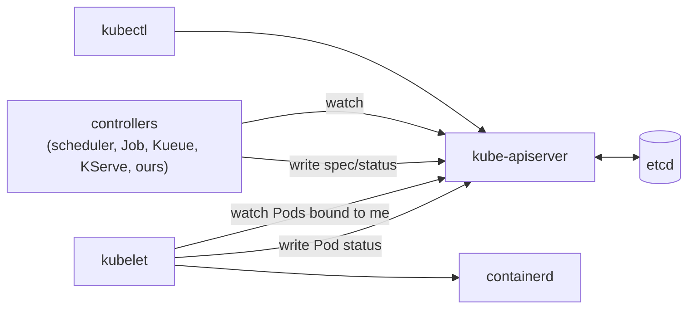

# What a Kubernetes cluster is made of

A cluster is one database with a validating REST API in front of it, plus a crowd of controllers
that read that API, compare it to the real world, and write back. Nothing in the list below is
special: the scheduler, the kubelet, Kueue, KServe, and the manager this repository builds are all
the same kind of program, differing only in which objects they watch and what they do about them.

Read this before [api-machinery.md](api-machinery.md), which is about the API they all share.

## The control plane

| Component                  | Owns                                                              | Fails by                                     |
| -------------------------- | ----------------------------------------------------------------- | -------------------------------------------- |
| `etcd`                     | the stored state, and only the API server talks to it             | losing quorum; the cluster becomes read-only |
| `kube-apiserver`           | REST, authentication, authorization, admission, validation, watch | nothing else works                           |
| `kube-scheduler`           | choosing a node for each unassigned Pod                           | Pods stay `Pending` with no node             |
| `kube-controller-manager`  | the built-in controllers (Deployment, Job, GC, …)                 | objects exist but nothing happens to them    |
| `cloud-controller-manager` | nodes, routes, and load balancers on a cloud                      | absent on kind; `LoadBalancer` Services hang |

The two rules worth memorizing:

- **Only the API server talks to `etcd`.** Everything else — including the scheduler, which looks
  like it should be privileged — is an ordinary API client over HTTPS.
- **Controllers never talk to each other.** They communicate by writing objects the other one
  watches. That is why this repository's convention is _never mutate another operator's resources
  beyond the fields you own_: the object is the protocol.



## On every node

- **kubelet** — the only component that runs containers. It watches for Pods whose `spec.nodeName`
  is its own node, asks the container runtime to make them real, and reports status back. It does
  not decide _what_ should run; the scheduler already did.
- **Container runtime** (containerd, via CRI) — pulls images and runs containers.
- **kube-proxy** — programs iptables/IPVS so a Service's cluster IP reaches a backing Pod. Being
  replaced by CNI dataplanes in many clusters.
- **CNI plugin** — gives each Pod its IP and wires it into the cluster network. kind uses kindnet.

## Add-ons, which are just more controllers

CoreDNS resolves Service names. metrics-server feeds `kubectl top`. In this platform, cert-manager,
Kueue, KServe, and the operator built here join the same crowd — each one a Deployment with a
ServiceAccount, RBAC rules, and a watch loop.

## See it in your kind cluster

kind runs the control plane as **static Pods**: manifests on disk that the kubelet runs directly,
with no scheduler and no Deployment involved. That is how the control plane bootstraps before the
control plane exists.

```bash
kubectl get nodes -o wide
kubectl get pods -n kube-system -o wide

# The static Pod manifests the kubelet reads from disk.
docker exec kind-control-plane ls /etc/kubernetes/manifests

# No Deployment owns the API server; the kubelet does.
kubectl get pod -n kube-system -l component=kube-apiserver -o yaml | grep -A5 ownerReferences

# Who is running, below Kubernetes.
docker exec kind-control-plane crictl ps
```

Then prove the second rule above — that controllers only meet in the API — by watching the handoff
of a single Pod:

```bash
kubectl run demo --image=nginx
kubectl get pod demo -o jsonpath='{.spec.nodeName}{"\n"}'   # written by the scheduler
kubectl get pod demo -o jsonpath='{.status.phase}{"\n"}'    # written by the kubelet
kubectl delete pod demo
```

The scheduler wrote one field, the kubelet read it and wrote another. Neither ever called the other.

## Where this platform fits

The operator in this repository is a Deployment in the `*-system` namespace like any other add-on.
It watches the custom resources described in
[../product/architecture.md](../product/architecture.md) and writes Kueue and KServe objects, which
those controllers then act on. The handoff is identical to the scheduler/kubelet handoff above, with
custom resources in place of `spec.nodeName`.
