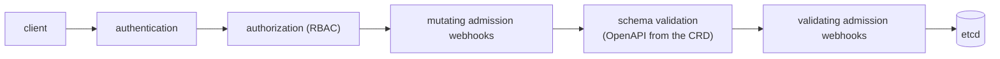

# Objects, the request path, and the control loop

[api-machinery.md](api-machinery.md) covers how an object is addressed and streamed. This one covers
what is inside it, what happens to a write on its way to `etcd`, and the loop every controller —
including this platform's — runs on the other side.

## Every object has the same four parts

```yaml
apiVersion: aiplatform.io/v1alpha1 # group/version
kind: Dataset # kind
metadata: # identity and bookkeeping
  name: imagenet-subset
  namespace: team-a
spec: # desired state — written by humans and other controllers
  uri: s3://bucket/imagenet
status: # observed state — written only by the owning controller
  conditions: []
```

The split is the whole model. **`spec` is intent, `status` is report.** A controller that writes its
own `spec` is arguing with its user; a user editing `status` is lying to the controller.

### The `metadata` fields that carry behavior

| Field               | Meaning                                                              |
| ------------------- | -------------------------------------------------------------------- |
| `uid`               | identity across deletion and recreation of the same name             |
| `resourceVersion`   | the optimistic-concurrency token; opaque                             |
| `generation`        | bumped by the server when `spec` changes, not when `status` does     |
| `labels`            | indexed, selectable, meant for grouping                              |
| `annotations`       | not indexed, meant for data other tools read                         |
| `ownerReferences`   | who owns this object; drives cascading deletion                      |
| `finalizers`        | names that must be removed before the object may actually be deleted |
| `deletionTimestamp` | set once deletion begins; the object lives on until finalizers drain |

**Owner references.** A child with `ownerReferences: [{uid, controller: true, …}]` is garbage
collected when its owner goes away — the cluster, not your code, does the cleanup. That is why this
repository requires _every child object carries an `ownerReference`_, and it is the same link
`Owns()` walks backwards to turn a child's event into a reconcile of the parent.

**Finalizers.** Deleting an object with a finalizer only sets `deletionTimestamp`. The object stays
visible, still reconciled, until the controller finishes its external cleanup and removes its own
finalizer string. A controller that is uninstalled while its finalizers remain leaves objects that
cannot be deleted — a mess worth seeing once, deliberately, before it happens by accident.

**Conditions.** `status.conditions` is the standard shape for reporting: `type`, `status`
(`True`/`False`/`Unknown`), `reason`, `message`, `observedGeneration`, `lastTransitionTime`.
Comparing a condition's `observedGeneration` to `metadata.generation` answers "is this report about
the spec I am looking at?".

```bash
kubectl get deploy -n kube-system coredns -o jsonpath='{.metadata.generation} {.status.observedGeneration}{"\n"}'
kubectl get replicaset -n kube-system -o custom-columns=NAME:.metadata.name,OWNER:.metadata.ownerReferences[0].name
```

k9s walks that second relationship instead of printing it: `:replicasets`, select a row, `shift-j`
jumps to the Deployment that owns it. One hop per press, so a chain of owners is a chain of presses
— which is the fastest way to confirm that a controller you wrote set the reference it was supposed
to set.

## What happens to a write

Every `create`, `update`, or `patch` runs this gauntlet inside the API server before anything is
stored:



Three things follow. Defaulting happens in mutating admission, so an object read back is not the
object you sent. Schema validation comes from the CRD, which is why Kubebuilder markers such as
`+kubebuilder:validation:Required` are enforced by the server and not by your Go code. And rules
that need to compare against _other_ objects, or against the previous version of this one — such as
the `Dataset` immutability rule in task 1.1 — can only live in a validating webhook, because the
schema sees one object with no history. The hands-on version of this is
[../curriculum/0.5-tls-and-admission.md](../curriculum/0.5-tls-and-admission.md).

## The control loop

A controller is a program that does this forever:

1. Take a key — `namespace/name` — off the workqueue.
2. `Get` the object from the cache. If it is gone, the work is to clean up (or nothing, if owner
   references already did).
3. Look at the real world: child objects, upstream resources, the artifact store.
4. Make the world match `spec` with the minimum number of writes.
5. Write `status` and emit an Event describing any transition.
6. Return: `nil` (done), an error (retried with backoff), or a requeue after a delay.

**Level-triggered, not edge-triggered.** The key on the queue says only _something about this object
may have changed_. It does not say what, and it may be a duplicate, a replay after a relist, or the
periodic resync. So step 3 reads the world instead of trusting the trigger. The practical test: if
your reconciler would behave differently when called twice in a row with no change in between, it is
edge-triggered and will eventually be wrong.

**Idempotence.** "Create the Job if absent, otherwise leave it alone" is a reconcile. "Create the
Job" is a bug that will produce two.

**Errors name the layer at fault.** A requeue that hides _which_ layer failed — quota, serving, the
model gate — turns a five-second diagnosis into an afternoon of log reading.

## Custom resources are not a special case

A CRD registers a group, version, kind, resource, scope, and OpenAPI schema. In return the API
server serves the full verb set at the new path, with the same watch semantics, the same
`resourceVersion` rules, the same admission chain, and — when the CRD declares one — the same
`/status` subresource. Nothing in [api-machinery.md](api-machinery.md) changes.

```bash
kubectl get crd                         # every extension installed in this cluster; k9s: :crds
kubectl get crd datasets.aiplatform.io -o jsonpath='{.spec.versions[*].name}{"\n"}'
kubectl api-resources --api-group=aiplatform.io
```

What a CRD does _not_ give you is behavior. The schema can reject a bad field, but it cannot create
a Job, flip a traffic split, or refuse a promotion. That is the controller's job, and it is what
this repository exists to write.
